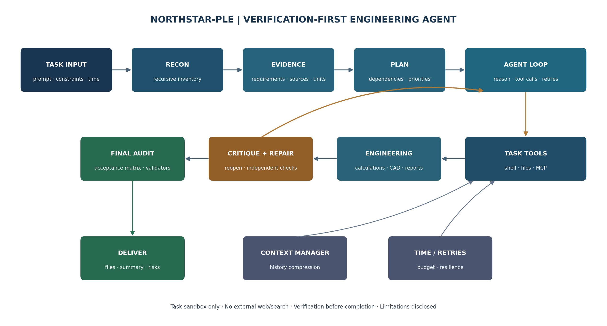
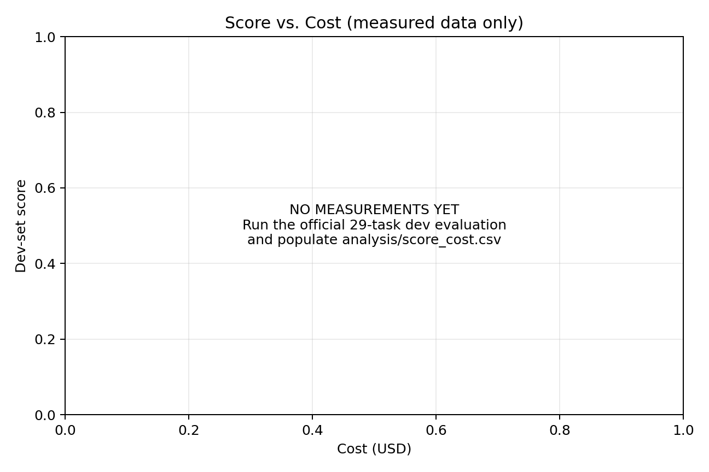
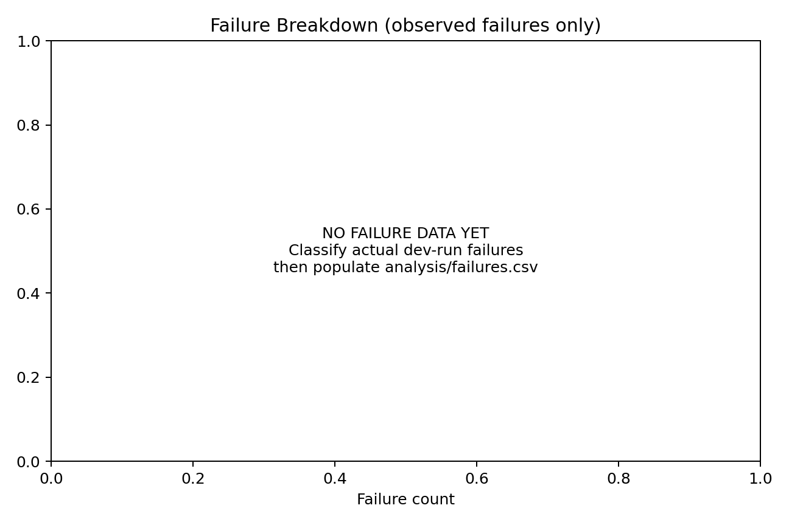

# NORTHSTAR-PLE: Evidence-First Verification Loops for Long-Horizon Engineering Agents

**Stage 1 draft — NOT YET SUBMITTED.** Replace the repository-link placeholder, attach `media/cover.jpg` to Kaggle Media Gallery, insert measured dev results into the plots and sections below, run all official checks, and submit the writeup before the deadline.

**Project Link:** `https://github.com/REPLACE_WITH_OWNER/NORTHSTAR-PLE`  
**Commit:** use the exact public commit shown by `git rev-parse HEAD` when submitting.

## Summary and approach

NORTHSTAR is a verification-first agent harness for PLE's multi-file engineering tasks. Rather than treating a task as a single answer, it drives the model through reconnaissance, requirements decomposition, evidence gathering, execution, and independent validation. Its WebSocket layer follows PLE protocol v1. The model operates only through the task's shell/file interface and registered task-local MCP servers; it has no web search or grader access.

The current entry uses `google-cloud/gemini-4-neon` (a provisional choice from the public leaderboard snapshot). All credentials are injected by the evaluator. The same OpenAI-compatible tool-call interface is used for model calls. The public leaderboard's model-agent scores are not a NORTHSTAR result and are not used as performance claims.

## 1. Insight and failure analysis (25)

The harness is designed around recurring failure modes in long engineering work: missing a drawing or workbook sheet, unsupported inputs, inconsistent units, cross-file contradictions, incomplete deliverables, wrong output paths, tool/API errors, and time-budget overruns. It creates a requirements matrix and evidence ledger, records source locations, exposes MCP schemas before use, and routes tool errors back to the model for recovery. A final workspace audit and skeptical review are required before the agent finishes.

**Observed failures and interventions:** official evaluation has not yet run. The categories above are hypotheses, not counts from the 29-task dev set. After evaluation, classify every task failure, record its task ID and contributing causes, and test targeted fixes. The failure figure currently says data are pending; it must be replaced by the measured dev-set breakdown.

## 2. Engineering reasoning (25)

For each task, the agent must map the prompt into deliverables and acceptance criteria, inspect project sources recursively, record evidence with file/page/sheet/row references and units, distinguish assumptions from source facts, and plan dependencies. Multi-step calculations are scripted when practical and checked independently by dimensional analysis, bounds, alternate methods, or test cases. It writes deliverables early, reopens them, checks formatting and formulas/geometry, and revises omissions. The final report lists outputs, tests actually run, and unresolved limitations. The writeup's case study will be a real dev task with anonymized or public task evidence, calculation path, output, and a reviewer check; it is not fabricated in this draft.

## 3. Cross-model generalizability (15)

The harness uses a model-neutral chat-completions adapter with injected endpoint/model credentials. This makes model switching a configuration change, but compatibility does not prove equal reasoning quality. A controlled dev-set experiment is planned with the same code, tool policy, and turn budget on at least two eligible models; report mean task score, runtime, cost, failure profile, and variance. No cross-model runs have been completed yet.

## 4. Efficiency and scaling (20)

The agent reserves time for final validation, caps tool turns, retries transient model failures with bounded exponential backoff, and compacts older conversation history into a progress ledger when the context grows. MCP catalogs are discovered concurrently, paginated, and searched instead of dumping large catalogs into the model prompt. Usage is reported per model call, including compaction. The experiment table will compare score versus dollar cost, tokens, elapsed time, tool-call count, and completion/verification rate. No measured cost or dev score is available yet.

## 5. Clarity and visuals (15)

The architecture figure documents the implemented system, while the score-cost and failure figures are deliberately marked as pending measured data. The cover image presents the four engineering disciplines and the agent's plan–reason–verify–deliver loop. These are implementation/design visuals, not performance evidence.

## Reproducibility and current limitations

Local checks use Python compilation, static entry checks, MCP parser/search unit tests, context-compaction regression tests, and a mock WebSocket/model smoke test. The smoke test does not score an engineering task. The official kit checks, public 29-task run, artifact validation, and offline artifact regrade are blocked in this environment because Docker, the official kit/runtime, accepted gated dataset access, and model-proxy credentials are not available. The `artifacts/` directory is intentionally absent rather than fabricated.

**Reproduction:** run the official kit `check`, then `eval/run.py`, then artifact validation and offline regrade as described in the repository README. Commit generated artifacts with the exact harness version. Do not submit until these checks and the measurements above are complete.

**Sources:** [PLE benchmark](https://ple-bench.com/), [official competition guide](https://ple-bench.com/competition/guide), [official kit and task repository](https://github.com/google-research/ple), [public dev dataset](https://huggingface.co/datasets/google/physical-engineerings-last-exam), and [competition page](https://www.kaggle.com/competitions/physical-engineerings-last-exam).\n\n**Safety:** PLE benchmark success is not professional licensure, engineering approval, or construction authorization. Real engineering decisions require qualified, jurisdiction-aware review.
